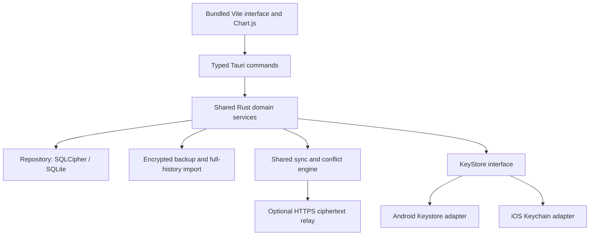

# TwinTrack offline application design

Status: proposed architecture, ready for review; no native application implemented.
Date: 15 November 2026. Branch: `dev_offline`.
Baseline: `main` at `5dd487adb03c61e1ac2461874b5c42c885114a9a`, including baby-name editing and confirmed birth date/time recording.

## 1. Decisions

Build a Tauri 2 application with the existing Vite/vanilla JavaScript interface and Chart.js, a shared Rust application core, and a SQLCipher-encrypted SQLite database on every device. Ship a single-device offline version before enabling optional end-to-end encrypted sync. Start real-device testing on Android; prove the same database and key-management boundaries on iOS early rather than waiting until the Android application is finished.

Use a Supabase ciphertext relay for the first automatic-sync implementation. It is an optional transport, not the authoritative database or the encryption-key custodian. Keep a transport interface so a different server can be added without changing domain logic or the backup format. Do not synchronize the live SQLite file.

These are design decisions, not claims that SQLCipher integration, mobile signing, device-key adapters, or sync have already been validated. An initial cross-platform feasibility milestone is a release gate.

Assumptions: one family, two babies, roughly 2–5 trusted devices, text/measurement records without photos, and access to an Android test phone. Actual phone ownership and availability of a Mac remain unconfirmed. If the family only uses iPhones and has a Mac, prioritize the iOS pilot instead; the shared architecture stays the same.

## 2. Goals and scope

- Create a family, log care, view history/charts, and edit permitted profile fields with no account, server, or internet connection.
- Keep local records encrypted and under the family's control; make encrypted export and tested restore first-class features.
- Preserve both babies' identifiers, historical activities, growth records, names, and birth details during migration.
- Offer explicit opt-in synchronization; disabling it never blocks local writes or reading history.
- Share the interface, validation, SQL migrations, encryption format, conflict rules, import/export, and sync protocol across Android and iOS.
- Prefer a small dependency set and predictable operational cost over extensive collaborative features.

First offline release: existing tracker functionality, local family setup, app lock, full-history import, encrypted backup/restore. First sync release: the owner's paired devices. Distinct caregiver accounts, invitations, revocation/key rotation, background scheduling, photos, medical interpretation, and public app-store launches are later milestones. Do not show the old caregiver-sharing UI as functional before its replacement exists.

## 3. Current implementation and changes needed

The repository currently calls Supabase directly from `src/main.js` for authentication, data reads/writes, and Realtime. The schema uses family membership and owner policies. The frontend persists an online auth session and holds fetched records in memory; there is no durable offline database or write queue. Its manifest provides install metadata, not offline storage.

The existing activity fetch is limited to 45 days/2,000 rows and growth to 500 rows. Existing CSV exports therefore cannot serve as a complete migration or backup. Birth date/time is intentionally immutable after confirmation; name updates remain permitted. All of these rules must move into the shared local domain service, not merely remain in JavaScript controls.

Keep the current hosted app working on `main`. Do not modify its production database during the design stage. Offline SQL migrations are independent of the current Supabase schema and its Row Level Security policies; SQLite has no equivalent per-user server boundary.

## 4. Architecture and ownership



The native application bundles all assets. It does not load the hosted website into a privileged WebView. Render data through safe text APIs or the existing escaping helper; use a restrictive CSP, no remote scripts, narrow Tauri command permissions, and no generic frontend SQL/filesystem/shell execution. Network access belongs to the optional native sync/import adapters. Offline mode must not initialize Supabase or send telemetry.

| Layer | Shared responsibilities | Platform-specific boundary |
| --- | --- | --- |
| UI | Screens, local state, charts, accessibility, sync/backup indicators | Safe areas, keyboard/lifecycle behavior |
| Domain services | Validation, family/baby identity, immutable birth details, history queries | None |
| Persistence | SQL migrations, transactions, repositories, outbox, conflict records | Private application directory |
| Crypto | Key separation, authenticated envelopes, backup serialization | OS entropy/secure-key access |
| Sync | Push/pull, retry, deduplication, conflict detection | Network availability/lifecycle hooks |
| Device services | Stable interfaces and errors | Keystore/Keychain, biometric unlock, file picker, share sheet |

Proposed layout (created during implementation, not all in this design commit):

```text
src/                        existing UI, incrementally separated into views/services
  services/native.js        typed command wrappers; no cloud calls in views
src-tauri/
  src/lib.rs                Tauri wiring and command registration
  crates/core/              domain types, validation, repositories, backup, sync
  src/platform/             platform adapter interfaces and implementations
  migrations/               versioned local SQL migrations
  capabilities/             minimal command permissions
  gen/android/              generated Android shell and small Kotlin bridge
  gen/apple/                generated iOS shell and small Swift bridge
sync/                       relay SQL/functions and contract tests, later milestone
```

Example commands: `create_family`, `list_babies`, `rename_baby`, `record_birth`, `save_activity`, `delete_activity`, `save_growth`, `query_history`, `create_backup`, `restore_backup`, `sync_now`. Validate structured arguments again in Rust. Database/key material never crosses IPC; only the records needed for the screen do. Use parameterized SQL and a serialized database worker off the UI thread. Return typed errors rather than SQL text or sensitive payloads.

## 5. Local database and domain rules

Choose `rusqlite` with bundled SQLCipher in the Rust core, subject to successful Android/iOS linkage. The official Tauri SQL plugin supports SQLite, but that alone does not prove SQLCipher encryption is enabled. Avoid a second SQLite-linked dependency and unrestricted SQL commands from JavaScript. Verify `cipher_version`, encrypted file contents, wrong-key rejection, and journal/temp behavior on actual builds. Review pinned library versions, licenses, and bundled crypto dependencies before implementation. [S1–S3]

| Local tables | Purpose |
| --- | --- |
| `families`, `babies`, `activities`, `growth` | Existing domain records with stable UUIDs and foreign keys |
| `device_identity`, `settings` | Local configuration; encrypted sensitive values |
| `operations`, `outbox` | Durable operations and encrypted upload queue |
| `applied_operations`, `sync_state` | Deduplication and per-workspace committed pull cursor |
| `conflicts`, `record_heads` | Concurrent versions awaiting explicit resolution |
| `schema_migrations` | Ordered, transactional schema upgrades |

Enable foreign keys. Use one transaction for each local domain change and its operation/outbox entry; a successful screen save means a durable local commit, never a network acknowledgment. Preserve creation identity and generate random UUIDs for new entities/operations. No physical deletion during initial sync: use durable tombstones. Paginate full local history and index `(baby_id, started_at)` and `(baby_id, measured_at)`; do not inherit the 45-day data-loss boundary.

Use UTC instants for care events and preserve imported offsets/values where present. Keep birth date and clock time as local civil values without timezone conversion, matching the current feature. Do not infer the birth timezone from a phone's current timezone. Each baby's confirmation is a separate immutable operation; enforce locally with validation and SQL guards.

Migrations execute transactionally after a verified recovery point. On failure, keep the original database and report recovery instructions; never silently create an empty replacement. Record format versions so older apps reject unsupported writes rather than corrupting data.

## 6. Encryption, unlock, and recovery

Threat model: protect copied device files, lost locked phones, accidental cloud backups, and a relay/database operator reading stored records. Exclusions: a compromised unlocked device, malicious signed application update, and an authorized caregiver retaining data they already read. Encryption does not prevent a server from withholding/deleting records or all rollback attacks.

Separate keys by purpose:

1. A random per-device database key encrypts SQLCipher. Wrap it using an OS-protected device key; it is not the Supabase password or an app PIN.
2. A random family sync key encrypts operation payloads before upload. Version key epochs to allow later rotation. Derive purpose-specific subkeys using a maintained crypto library.
3. Separate device signing/pairing keys identify authorized writers; use a reviewed protocol/library, not a homegrown exchange.
4. A separate portable recovery secret protects backup/recovery material. OS-only keys cannot recover a database on another phone.

Android Keystore holds a non-exportable wrapping key; Rust receives the unwrapped SQLCipher key only after permitted unlock. Hardware backing varies by device and must be detected, not promised. iOS uses Keychain with a device-only, unlocked accessibility policy; select the exact access-control/biometric policy in the native feasibility milestone. These platform adapters intentionally differ while the core `KeyStore` interface is shared. [S4–S5]

Default: require device authentication to unlock, close database connections and clear sensitive UI/key references on lock/background timeout, and reauthenticate on return. Minimize plaintext lifetime and avoid logging keys, record bodies, tokens, or SQL parameters. Best-effort memory clearing is not a guarantee that all WebView/OS copies vanish. Foreground sync while unlocked is the initial supported mode; do not promise background sync with unavailable keys.

Use an established authenticated-encryption implementation for sync/backup envelopes, proposed XChaCha20-Poly1305 with fresh cryptographic nonces. Authenticate workspace ID, operation ID, format version, and key epoch as associated data. Sign the canonical envelope with the paired device's signing key to distinguish authorized writers; review serialization, nonce handling, key derivation and pairing before enabling sync. Keep all cryptographic operations in shared Rust.

Backup UI creates a versioned encrypted logical archive of all records, conflicts, tombstones and required history, with an authenticated manifest. Use an independent randomly generated recovery secret, show/save it separately, and require a restore rehearsal. If passphrase-based backup is offered later, use a calibrated Argon2id derivation with stored salt/parameters; a short PIN is insufficient. A login-password reset cannot restore encryption keys. Lost devices plus lost recovery material means unrecoverable data. Restoring creates a fresh per-device database key, device ID and signing identity; never clone an old device's live credentials/counters. The archive includes the family key material needed for its history inside the recovery-encrypted payload, but excludes relay sessions and OS wrapping keys. Restore history and pending operations idempotently, then re-enroll the new device before uploading; do not blindly replay copied outbox credentials. Document whether an archive restores a replacement vault or imports into an existing one, and require confirmation before replacement.

Exclude database, journals, wrapped keys, and auth tokens from automatic OS cloud/device-transfer backup; verify exclusions on real devices. Offer only explicit portable encrypted exports for recovery. Android includes many app files in Auto Backup by default, so local-only operation requires explicit configuration. Define equivalent iOS backup exclusions. Exported files may be uploaded by whatever destination the user selects. [S6]

## 7. Sync alternatives and cost

All costs below are indicative USD, checked 15 November 2026, before taxes, hardware, build services, email delivery, and usage overages. Free-tier suitability is a workload estimate, not a service guarantee. No paid service is required for the offline application.

| Option | Privacy and implementation | Expected family-scale cost | Decision |
| --- | --- | --- | --- |
| Encrypted manual export/import | No server; portable recovery; replacing a vault differs from merging operations | $0 service cost | Ship for backup/restore first; not marketed as automatic multi-writer sync |
| Supabase ciphertext relay | Reuse account familiarity; RLS/HTTPS plus local E2EE; custom operation protocol still required | Free pilot within quotas; Pro starts at $25/month, extras possible | Recommended first automatic-sync transport [S7] |
| Cloudflare Worker + R2, with transactional index/auth | Ciphertext objects; cheap storage, but must build authorization, cursors, ordering and pairing backend | Free allowances may cover pilot; R2 Standard beyond allowance $0.015/GB-month; Worker paid minimum $5/month, plus applicable usage/index costs | Candidate if Supabase cost/pausing becomes unacceptable [S8–S9] |
| Drive/iCloud/WebDAV encrypted operation files | User-controlled account; OAuth/provider differences, file discovery and conflict logic | Possibly existing storage plan; engineering/operational costs remain | Later adapter; iCloud-only solution fails Android parity |
| LAN peer-to-peer | No cloud record copies; requires devices online together, discovery and authenticated pairing | $0 hosting; higher engineering/support effort | Later, not the first reliable sync route |
| Self-hosted relay | Full hosting control, still encrypt before upload | Server/storage/backups plus administration; no fixed price assumed | For a user willing to operate it, not lowest-maintenance default |
| Managed SQLite sync (for example Turso) | Can reduce replication work, but mobile/SQLCipher compatibility and provider-blind E2EE need a specific proof | Provider-specific usage pricing; not costed without selected integration | Reconsider only if it passes the security/platform gates; BYOK alone does not prove E2EE [S10] |

Do not use Drive/Syncthing/iCloud to copy a database currently open on two devices: file replacement is not transaction/record merging, and SQLite journals make live copying unsafe. Consistent encrypted snapshots are useful backups, not a solution for two writers.

Pilot estimate: 100 operations/day × 365 × 2 KiB/envelope is about 71 MiB/year of raw envelopes; budget 150–250 MiB including indexes and metadata, excluding snapshots and attachments. With four devices, 20 bounded foreground sync sessions/device/day at about three requests/session is roughly 7,200 requests/month; actual downloads depend on batch size/retries/history bootstrap. Measure real row/index growth and egress. Supabase Free currently lists 500 MB database and 5 GB egress; low activity may pause it after a week, so the app must tolerate an unavailable relay indefinitely. [S7]

No always-on Realtime subscription or continuous polling initially. Sync on explicit request, app foreground, and debounced local changes while unlocked; use bounded batches, timeouts, exponential backoff with jitter, and a clear last-success/pending/error indicator. A relay outage never loses accepted local writes. Free hosting is not a backup strategy.

## 8. Relay and synchronization protocol

Initial scope: owner's paired devices, with separate revocable device credentials. Use a separate relay schema/project rather than retrofitting encrypted bodies into current readable tables. Online identity is optional and appears only when enabling sync; its credentials live in native secure storage, not WebView localStorage. Auth-token expiry must not lock the offline vault.

The relay stores opaque workspace/device/operation IDs, encrypted envelopes, signatures, key epoch, committed sequence, and upload time. Baby names, birth details, record types, clinical values, and readable notes stay inside ciphertext. Account identity, device relationships, timing, lengths and traffic remain visible. RLS and native API authorization enforce membership; no service-role credential ships in the app. Deny direct client modification of membership and existing operation rows.

1. First device creates a sync workspace and key. Pair a second device using an expiring one-time QR/deep-link session, an authenticated ephemeral key exchange, and a comparison code or owner approval on both devices. Never put an unwrapped family key in a URL, log, or notification. Detailed pairing/key-recovery protocol gets its own reviewed specification before implementation.
2. Every local change writes an immutable operation containing entity ID, parent revision IDs, payload/tombstone, device identity, and format version in the same transaction as the domain update. Queue the authenticated encrypted envelope for upload. Exclude transport/local-only secrets from operations.
3. Push is idempotent by `(workspace_id, operation_id)`; retry returns the original acknowledgment. Reject the same ID with different bytes. Reject revoked writers, unsupported envelope sizes, and unauthorized workspace access.
4. Assign pull sequence inside a server transaction serialized per workspace (for example, lock a workspace counter row, increment it, insert, commit). A bare `bigserial` is insufficient: transactions can commit out of sequence and a client advancing its cursor could skip a late commit. Upload acknowledgment and sequence publication share a transaction.
5. Pull committed envelopes in sequence, bounded by a fixed high-water mark per paging cycle. Verify signature, decrypt, validate domain rules, and atomically persist both applied IDs and updated pull cursor with local changes. Advance only after durable commit. Reject or quarantine invalid/unknown envelopes and visibly block that cursor rather than silently skipping records. A downloaded self-authored operation is deduplicated.
6. On restart, replay unacknowledged outbox items. A crash after server commit but before local acknowledgment is safe through idempotency. No wall-clock timestamp is used as the sole ordering or conflict authority.
7. Keep the full operation history for the small pilot. Garbage collection/snapshots require a later protocol covering dormant/revoked devices and validated bootstrap. Do not prune tombstones just because they are old.

Conflicts use parent revision IDs: independent additions merge; a sequential edit replaces its parent; concurrent heads are retained. Do not silently discard a caregiver's note with last-write-wins. Present concurrent edits/deletion-versus-edit for explicit resolution; hide a disputed deleted entry from normal totals until resolved and show a conflict badge. A resolution operation names all conflicting parents. Histories and charts display each entity once.

For simultaneous first birth confirmations, retain both claims and mark the profile disputed until the owner explicitly selects one via a conflict-resolution operation. Ordinary editing remains unavailable. Global one-time uniqueness cannot be guaranteed while both devices are offline; claiming otherwise would be misleading. Resolving a concurrent initial claim is a documented exception, not general birth editing.

Later caregiver support requires signed owner-authorized membership events, explicit roles, online pairing checks, per-device credentials, and key-epoch rotation. Revocation stops future relay access and future key delivery, not previously decrypted copies. Define what happens to offline pending edits from a revoked device before releasing sharing. A server withholds data or rolls back history can harm availability/freshness; signatures and locally remembered heads detect some tampering, but v1 does not claim complete protection against a malicious relay presenting a stale history to a brand-new device.

## 9. Android versus iOS

| Factor | Android | iOS |
| --- | --- | --- |
| Development host | Linux/macOS/Windows with Android tooling | macOS and Xcode required for native builds |
| Initial installation | Signed APK installed directly on a controlled test phone; public store release deferred | Xcode development provisioning for personal tests; TestFlight/App Store adds membership/distribution setup |
| Shared core | Rust/SQLCipher/domain/sync/backup | Same Rust/SQLCipher/domain/sync/backup |
| Native differences | Keystore, biometric policy, file picker, backup rules, back button | Keychain, biometric policy, document picker, backup rules, safe areas |
| Test priorities | App termination, storage pressure, WebView diversity, key invalidation | Suspension, provisioning, key accessibility, WKWebView/lifecycle behavior |

Recommendation: Android first because the available development environment is Linux and direct pilot installation avoids an initial store workflow. This is a tooling/cost decision, not a claim Android is inherently more secure. Tauri documents both mobile toolchains. Apple offers limited free personal development, while its Developer Program is $99/year or local equivalent; Mac hardware/build access is an additional consideration. Free personal provisioning expires after seven days and needs rebuilding/reinstallation, which makes it less convenient for an ongoing family pilot. [S1, S11–S12]

Use a recent supported Android device for the pilot; choose the exact minimum API level after dependency review, and test at least two OS versions and one real phone. Generate an iOS target and demonstrate create/encrypt/reopen/restore using the same core in milestone 0 when Mac access is available. Lack of a Mac must be tracked as an unverified portability gate, not treated as iOS completion. Keep public-store policy, SDK/NDK/Xcode versions, and signing requirements as release-time checks rather than hardcoding unverified minimum versions here.

## 10. Migration from the hosted application

1. Add a dedicated full-history, paginated exporter/importer under an authenticated family account. Do not use the current UI's truncated arrays/CSV. Export family, babies, all activities and growth, preserving UUIDs, attribution and timestamps; omit invitation tokens and auth sessions.
2. Validate counts, references, units, date/time values, required fields, and archive version. Import transactionally into a new encrypted local vault. Store an import manifest and prevent duplicate imports by source/ID. Attribute old entries to legacy actor IDs without granting those actors device access.
3. Prefer streaming directly into the encrypted import pipeline. If any plaintext staging file is unavoidable, warn explicitly, restrict its location/lifetime and remove it after success; do not claim secure erasure on flash storage. Never place family exports in Git or CI artifacts.
4. Reconcile counts, oldest/newest dates, totals and samples for each baby; record any rejected rows. A full import either commits or leaves the original vault intact.
5. Make an encrypted backup and restore it on a second clean installation. Then cut over logging. Temporarily freeze hosted writes or capture a final verified delta; do not maintain two independent live writers without a bridge.
6. Enable encrypted sync only after offline data/recovery tests pass. Retiring old readable cloud records, accounts and backup retention is a separate owner-authorized step. No automatic cloud deletion during import.

## 11. Delivery milestones and acceptance gates

| Milestone | Deliverable | Required evidence |
| --- | --- | --- |
| 0: native/security feasibility | Tauri shell, shared Rust crate, SQLCipher, KeyStore adapters | Android real-device encrypted reopen/wrong-key checks; iOS build/secure-key round trip when Mac available; measure installed size, startup and write latency |
| 1: offline feature parity | Local setup, care/growth/history/charts, editable names, immutable birth details | Fresh install and restart in airplane mode; no network attempts; transactional migrations and forced-kill durability |
| 2: recovery and migration | Versioned encrypted archives; full Supabase import | Wrong secret/tampered archive rejected; complete-history import beyond old limits; second-install restore; count reconciliation |
| 3: owner's encrypted sync | Reviewed envelope/pairing spec, relay, outbox and conflicts | Two devices offline concurrently, repeated/reordered uploads, interrupted push/pull, clock skew, deletion conflicts and birth disputes converge without duplicates/loss |
| 4: iOS parity pilot | Same core and formats in iOS shell | Android↔iOS backup compatibility and sync, lifecycle/lock/picker checks; no domain or crypto fork |
| 5: optional caregiver sharing | Role-aware pairing, membership, revocation, rotation | Removed device denied new access; old key cannot decrypt new epoch; clear handling of rejected pending edits |

Common verification: Rust domain/migration/crypto-format tests on CI, transport contract tests against a disposable relay, and mobile UI tests/manual device scripts. Test encrypted database/WAL/temp files for recognizable fixture text, no sensitive logs, OS-backup exclusions, auth-token expiry, full-disk writes, schema-upgrade failure, application kill during transactions, and loss of keys. Preserve a known-good backup before upgrade tests. Do not upload real family records to test environments.

Provisional size/performance budgets are measurements to establish in milestone 0, not promised numbers. If bundled crypto is too large/slow or iOS linkage fails, revisit the repository adapter behind the same interface before feature implementation. Never silently downgrade to unencrypted SQLite.

## 12. Immediate next work and open gates

This commit creates the design only. Next implement milestone 0 in small reviewable commits on `dev_offline`; keep production deployment limited to `main` and never embed signing keys in the repository. Pin dependencies/lockfiles and protect Android signing credentials so later updates can open the same vault.

Before a real-device pilot, confirm available Android/iOS phones, Mac access, and recovery-secret storage preference. Before automatic sync, approve the envelope/pairing design and decide whether to reuse an existing Supabase organization or isolate a free pilot project. A Supabase integration in Codex is optional for writing code/migrations; applying relay changes needs authorized access or manual SQL deployment. No subscription purchase or production migration is implied by this design.

## Sources and verification boundaries

Primary documentation consulted 15 November 2026. Prices/quotas and platform policies should be rechecked before purchase/release. Implementation decisions above are our proposed design, not claims that providers supply the entire system.

- S1: [Tauri prerequisites and mobile toolchains](https://v2.tauri.app/start/prerequisites/).
- S2: [Tauri SQL plugin](https://v2.tauri.app/plugin/sql/).
- S3: [rusqlite SQLCipher feature options](https://github.com/rusqlite/rusqlite/blob/master/README.md); [SQLCipher design and temporary-file considerations](https://www.zetetic.net/sqlcipher/design/).
- S4: [Android Keystore and hardware-backed key limitations](https://developer.android.com/privacy-and-security/keystore).
- S5: [Apple device-only unlocked Keychain accessibility](https://developer.apple.com/documentation/security/ksecattraccessiblewhenunlockedthisdeviceonly).
- S6: [Android Auto Backup behavior and exclusions](https://developer.android.com/identity/data/autobackup).
- S7: [Supabase pricing, quotas and inactivity pausing](https://supabase.com/pricing).
- S8: [Cloudflare R2 pricing](https://developers.cloudflare.com/r2/pricing/).
- S9: [Cloudflare Workers pricing](https://developers.cloudflare.com/workers/platform/pricing/).
- S10: [Turso local-first product overview](https://turso.tech/solutions/local-first); exact security/compatibility integration remains unevaluated.
- S11: [Apple free account versus membership](https://developer.apple.com/help/account/basics/about-your-developer-account).
- S12: [Apple Developer Program enrollment fees](https://developer.apple.com/help/account/membership/program-enrollment).
